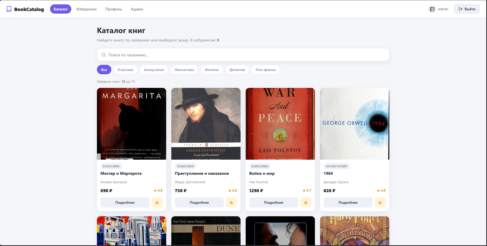
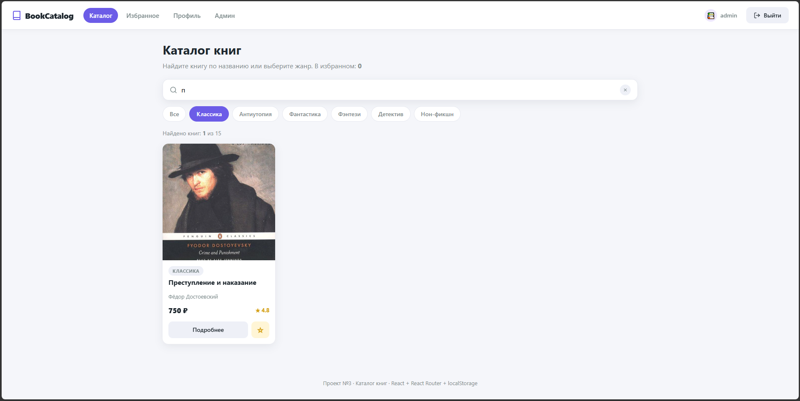
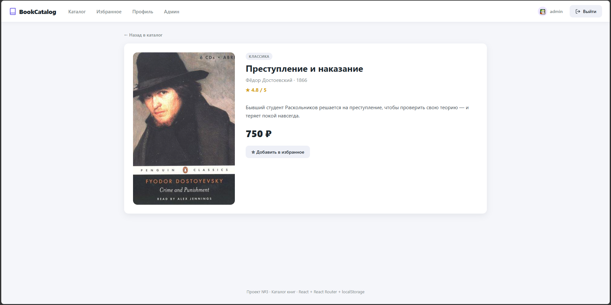
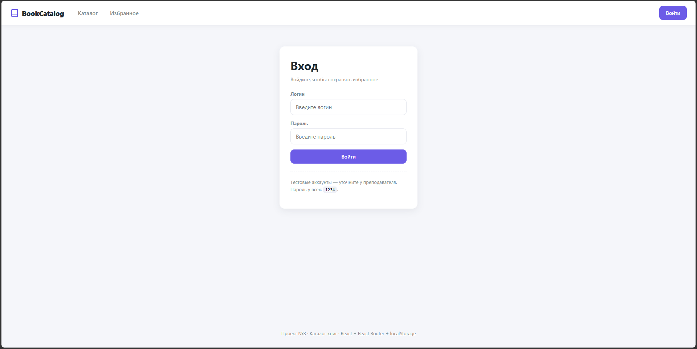
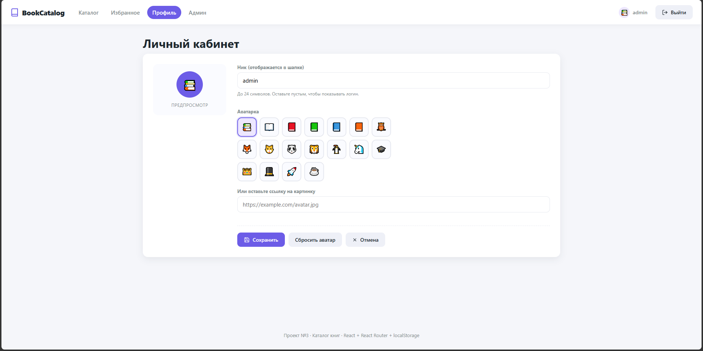
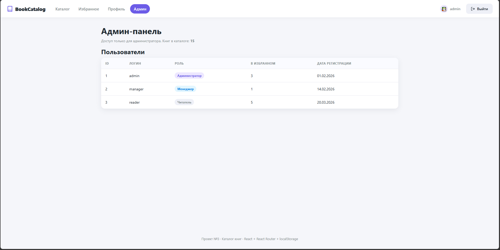

# 📚 BookCatalog — Каталог книг с поиском

> Учебный React-проект: каталог книг с поиском, фильтром по жанрам, страницей книги, избранным в `localStorage`, авторизацией и редактированием профиля.

<p align="left">
  
  
  
  
  
</p>

---

## ✨ Возможности

### 📖 Каталог

- 15 книг с обложками, описаниями и рейтингами
- **Поиск по названию** в реальном времени
- **Фильтр по жанрам** (Классика, Антиутопия, Фантастика, Фэнтези, Детектив, Нон-фикшн)
- Комбинированная фильтрация: поиск + жанр одновременно
- Адаптивная сетка карточек (`auto-fill`)

### 📄 Страница книги `/book/:id`

- Большая обложка, автор, год, рейтинг, описание
- Добавление/удаление из избранного
- Кнопка «Назад в каталог»

### ⭐ Избранное

- Сохраняется в `localStorage` — не теряется при перезагрузке
- Отдельная страница `/favorites`
- Счётчик избранного в шапке

### 🔐 Авторизация (мок, без сервера)

- Форма входа `/login`
- Три роли: `admin`, `manager`, `user`
- Роли и логин сохраняются в `localStorage`

### 🛡 Защита маршрутов

- `PrivateRoute` — только для авторизованных (`/profile`, `/favorites`)
- `AdminRoute` — только для администратора (`/admin`)
- Редирект с запоминанием исходной страницы (`state.from`)

### 👤 Профиль

- Просмотр ника, логина и роли
- **Редактирование ника** (до 24 символов)
- **Редактирование аватарки**: emoji-пресеты или ссылка на картинку
- Данные сохраняются в `localStorage`

### 🎨 UI/UX

- Собственный набор **SVG-иконок** (без внешних библиотек)
- Fallback для битых обложек — цветной блок с названием и автором
- Пустые состояния с иконками
- Страница 404
- Плавные hover-эффекты и переходы
- Мобильная адаптация

---

## 🛠 Стек

| Технология         | Назначение                                                |
| ------------------ | --------------------------------------------------------- |
| **React 18**       | UI, компоненты, хуки (`useState`, `useEffect`, `useMemo`) |
| **React Router 6** | Маршрутизация, `useNavigate`, `Navigate`, `NavLink`       |
| **Vite 5**         | Сборка и dev-сервер                                       |
| **localStorage**   | Избранное, авторизация, профиль                           |
| **Чистый CSS**     | Стилизация без UI-библиотек                               |

Никаких внешних UI-kit'ов — всё написано руками.

---

## 🚀 Быстрый старт

### Требования

- Node.js **18+**
- npm или yarn

### Установка

```bash
# 1. Клонировать репозиторий
git clone https://github.com/legyxan/book-catalog.git
cd book-catalog

# 2. Установить зависимости
npm install

# 3. Запустить dev-сервер
npm run dev
```

Откройте [http://localhost:5173](http://localhost:5173).

### Сборка продакшена

```bash
npm run build      # собирает в папку dist/
npm run preview    # локальный предпросмотр сборки
```

---

## 🔑 Тестовые аккаунты

> Пароль у всех — `1234`

| Логин     | Пароль | Роль          | Доступ                      |
| --------- | ------ | ------------- | --------------------------- |
| `admin`   | `1234` | Администратор | Всё + `/admin`              |
| `manager` | `1234` | Менеджер      | Каталог, профиль, избранное |
| `reader`  | `1234` | Читатель      | Каталог, профиль, избранное |

---

## 🗺 Маршруты

| Путь         | Доступ            | Компонент    | Описание                                       |
| ------------ | ----------------- | ------------ | ---------------------------------------------- |
| `/`          | всем              | `Home`       | Каталог с поиском и фильтром                   |
| `/book/:id`  | всем              | `BookPage`   | Страница книги                                 |
| `/login`     | всем              | `Login`      | Форма входа                                    |
| `/favorites` | 🔒 авторизованным | `Favorites`  | Избранное                                      |
| `/profile`   | 🔒 авторизованным | `Profile`    | Личный кабинет + редактор профиля              |
| `/admin`     | 👑 только admin   | `AdminPanel` | Панель администратора со списком пользователей |
| `*`          | всем              | `NotFound`   | 404                                            |

---

## 📁 Структура проекта

```
src/
├── App.jsx                       # Роутер + состояние авторизации
├── main.jsx                      # Точка входа + BrowserRouter
├── index.css                     # Все стили проекта
│
├── data/
│   └── books.js                  # 15 книг + жанры
│
├── hooks/
│   └── useFavorites.js           # Хук избранного + localStorage
│
├── pages/
│   ├── Home.jsx                  # Каталог: поиск + фильтр
│   ├── BookPage.jsx              # Страница книги
│   ├── Favorites.jsx             # Избранное
│   ├── Login.jsx                 # Форма входа
│   ├── Profile.jsx               # Профиль + редактирование
│   ├── AdminPanel.jsx            # Админ-панель
│   └── NotFound.jsx              # 404
│
└── components/
    ├── Navbar.jsx                # Шапка с аватаром и меню
    ├── BookCard.jsx              # Карточка книги
    ├── BookCover.jsx             # Обложка с fallback
    ├── SearchBar.jsx             # Поиск
    ├── GenreFilter.jsx           # Чипы-жанры
    ├── PrivateRoute.jsx          # Защита: только авторизованным
    ├── AdminRoute.jsx            # Защита: только admin
    └── Icons.jsx                 # Набор SVG-иконок
```

---

## 💡 Ключевые решения

### Хук `useFavorites`

Избранное хранится в `useState` и синхронизируется с `localStorage` через `useEffect`:

```js
useEffect(() => {
  localStorage.setItem('favorites', JSON.stringify(favorites));
}, [favorites]);
```

### Защита маршрутов

`PrivateRoute` проверяет `localStorage.getItem('user')` и редиректит на `/login`, сохраняя исходный путь:

```jsx
if (!user) return <Navigate to="/login" replace state={{ from: location }} />;
```

### Fallback обложек

Компонент `BookCover` при `onError` показывает цветной блок с названием и автором — вместо иконки «сломанной картинки».

### Иконки без библиотек

10 SVG-иконок в `Icons.jsx`, наследуют цвет через `stroke="currentColor"`. Никаких `react-icons` и `lucide` — 0 КБ зависимостей.

### Поиск с `useMemo`

Фильтрация по названию и жанру пересчитывается только при изменении `search` или `genre`:

```js
const filtered = useMemo(() => {
  return books.filter(b =>
    b.title.toLowerCase().includes(search.toLowerCase()) &&
    (genre === 'Все' || b.genre === genre)
  );
}, [search, genre]);
```

---

## 📸 Скриншоты

| Каталог                                | Поиск + фильтр                      |
| -------------------------------------- | ----------------------------------- |
|  |  |

| Страница книги                    | Форма входа                       |
| --------------------------------- | --------------------------------- |
|  |  |

| Профиль (редактор)                     | Админ-панель                       |
| -------------------------------------- | ---------------------------------- |
|  |  |

> 📝 Добавьте папку `screenshots/` в корень проекта и положите туда изображения.

---

## 🎯 Чему учит проект

- Работа с `useState`, `useEffect`, `useMemo` в реальных сценариях
- **React Router**: `Routes`, `Route`, `Link`, `NavLink`, `useNavigate`, `useParams`, `Navigate`, `useLocation`
- **Защита маршрутов** через компоненты-обёртки
- **Хранение состояния** в `localStorage` и синхронизация с React-состоянием
- **Разделение ответственности**: компоненты / страницы / данные / хуки
- Композиция компонентов без внешних UI-библиотек
- Работа с SVG-иконками через `currentColor`

---

## 🔮 Что можно улучшить

- [ ] Перевести данные в **TypeScript**
- [ ] Заменить мок-логин на реальный API (JWT в httpOnly cookies)
- [ ] Добавить сортировку (по цене, рейтингу, году)
- [ ] Пагинация или бесконечный скролл
- [ ] Панель фильтров по цене/году
- [ ] Тесты (`Vitest` + `React Testing Library`)
- [ ] Тёмная тема
- [ ] Мобильное приложение (React Native)

---

## 📄 Лицензия

Проект распространяется под лицензией **MIT** — используйте свободно в учебных и личных целях.

---

## 👤 Автор

**Влад**

- GitHub: [@legyxan](https://github.com/legyxan)
- Email: [vlad.drozdov.08@list.ru](mailto:vlad.drozdov.08@list.ru)

---

<p align="center">
  <sub>Сделано с ❤️ на React + Vite</sub>
</p>
